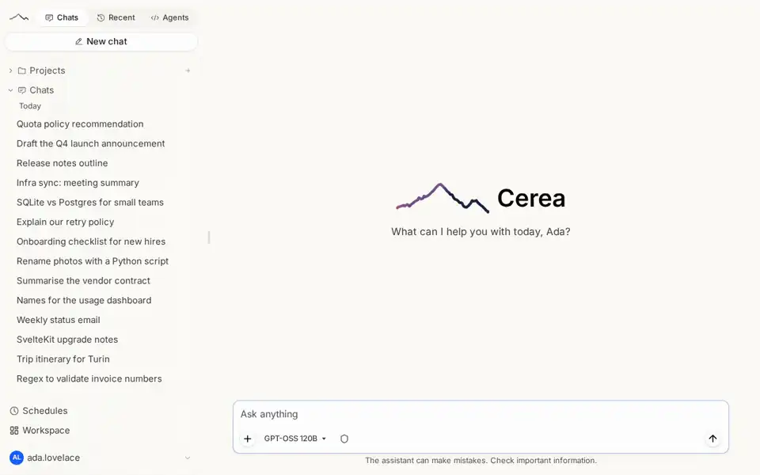

<p align="center">
  <picture>
    <source media="(prefers-color-scheme: dark)" srcset="static/chatui/logo-white.svg">
    
  </picture>
</p>

# Cerea

**Self-hosted chat and coding agents for teams: every user with their own spend, quotas and privacy rules.**

<p align="center">
  <a href="docs/assets/cerea-demo.mp4" title="Watch the demo as a video">
    
  </a>
</p>

## Try it in 5 minutes

You need Docker. The **deploy kit** (the `kit/` directory of this repository)
runs the full stack: the chat, the Pystino gateway and its console, a bundled
identity provider, a TLS proxy and the add-ons. Its installer fetches only that
directory:

```sh
curl -fsSL https://raw.githubusercontent.com/paoloviviani/Cerea/stable/kit/get-kit.sh | sh
cd cerea/kit
./configure
docker compose up -d
```

For a chat-only install, against a central Pystino (`--preset satellite`) or any
OpenAI-compatible endpoint without Pystino (`--preset generic`), and for what each
shape gives and lacks, see [docs/deploy.md](docs/deploy.md). The chat also runs
without the kit.

<p align="center">
  <a href="https://github.com/paoloviviani/Cerea/releases/latest"></a>
  <a href="LICENSE"></a>
  <a href="https://paoloviviani.github.io/Cerea/"></a>
</p>

## Why Cerea

- **Every user has their own account at the gateway.** With
  [Pystino](https://github.com/paoloviviani/Pystino), each call carries the
  signed-in user's own token, so spend, quotas and model access are per user
  and per group, not one shared key.
- **Privacy rules before the model.** With Pystino, administrators write
  pipelines whose rules act on content: redact or anonymise personal data
  and secrets, or refuse the request, for chat, embeddings and document
  reading, before anything reaches a provider.
- **Coding agents on your own computers.** The `/code` panel drives agents on
  machines you pair, in Plan, Ask or Allow mode, with approval cards for what
  they want to do, which you can answer from a phone.
- **Artifacts and Office files.** HTML, React and Mermaid previews, and Word,
  Excel, PowerPoint and PDF files the assistant creates and edits.
- **Python in your browser, or in a server sandbox.** By default a WebAssembly
  sandbox on your device, so files stay there; or, when the operator enables
  it, a gVisor sandbox on the server.
- **One connector list** (MCP servers) for the chat and for your agents.

## How it compares

Cerea with its gateway Pystino, next to other self-hosted chat apps, agent platforms and
LLM gateways.

Key: ✓ built in · ~ partial, add-on or paid tier · — not offered · ? not verified ·
■ ours alone. Checked 18 November 2026.

|                                                       |   Open WebUI    | LibreChat |   Onyx   |      Dify       | LiteLLM  | Envoy AI GW |   Coder   |  **Cerea + Pystino**  |
| ----------------------------------------------------- | :-------------: | :-------: | :------: | :-------------: | :------: | :---------: | :-------: | :-------------------: |
| Chat UI for end users                                 |        ✓        |     ✓     |    ✓     |        ✓        |    —     |      —      |     ~     |         **✓**         |
| Agents with tools                                     |        ✓        |     ✓     |    ✓     |        ✓        |    —     |      —      |     ✓     |         **✓**         |
| MCP                                                   |        ~        |     ✓     |    ✓     |        ✓        |   ✓ gw   |    ✓ gw     |     ?     | **✓ incl. your own**  |
| Knowledge bases / search                              |        ✓        |     ✓     |    ✓     |        ✓        |    —     |      —      |     —     |         **✓**         |
| Code execution                                        |        ✓        |     ✓     |    ✓     |        ✓        |    —     |      —      |     ✓     |         **✓**         |
| ■ Office files: create, edit, version                 |        —        |     —     |    —     |        —        |    —     |      —      |     —     |         **✓**         |
| Coding agents on your own machines, from the chat     |        —        |     —     |    —     |        —        |    —     |      —      |     ~     |         **✓**         |
| ■ Browser use in your own signed-in browser           |        —        |     —     |    —     |        —        |    —     |      —      |     —     |         **✓**         |
| Visual workflow builder                               |        —        |     —     |    —     |        ✓        |    —     |      —      |     —     |         **—**         |
| Budgets / rate limits per user or group               |        —        |     ~     |    ?     |        ?        |    ✓     |      ✓      |     ~     |         **✓**         |
| PII redaction before the model                        |        ~        |     —     |    ?     |        —        |    ✓     |      —      |     ?     |         **✓**         |
| One sign-in across chat, gateway and agents           |        —        |     —     |    —     |        —        |    —     |      —      |     ~     |         **✓**         |
| ■ From your phone, tools running on your own computer |        —        |     —     |    —     |        —        |    —     |      —      |     —     |         **✓**         |
| Licence                                               | custom, not OSI |    MIT    | MIT + EE | modified Apache | MIT + EE | Apache-2.0  | AGPL + EE | **Apache-2.0, no EE** |

Corrections welcome: please open an issue.

## Cerea and Pystino

Cerea is one half of a pair, and each half runs on its own:

- **Cerea** (this repository) is for the users of models: the chat, its knowledge,
  artifacts and tools, and **galopin**, which pairs coding agents on a user's own
  computer.
- **[Pystino](https://github.com/paoloviviani/Pystino)** is for the organisation paying
  for them: an OpenAI- and Anthropic-compatible gateway with per-user and per-group
  accounting, quotas, PII redaction, model access and an admin console.

Cerea alone runs against any OpenAI-compatible endpoint with one shared key. Together,
each call carries the signed-in user's own token, so spend, quotas and model access
follow the user. The deploy kit in this repository runs both, or the chat alone.

## Documentation

Everything else is on the documentation site, **[paoloviviani.github.io/Cerea](https://paoloviviani.github.io/Cerea/)**:
the [full feature list](https://paoloviviani.github.io/Cerea/docs/features/), using the chat
and the agents, deploying and configuring, and the reference. Pystino has
[its own documentation](https://paoloviviani.github.io/Pystino/).

## Contributing, security, licence

[CONTRIBUTING.md](CONTRIBUTING.md) covers development, tests and releases;
[SECURITY.md](SECURITY.md) how to report a vulnerability. Cerea is Copyright 2026
Paolo Viviani and licensed under the [Apache License 2.0](LICENSE). It is a hard fork of
an earlier open-source chat UI; [NOTICE](NOTICE) carries that attribution and the
third-party notices. How the code was written is disclosed in
[AI-DISCLOSURE.md](AI-DISCLOSURE.md).

## Acknowledgments

This work is supported by [LINKS Foundation](https://linksfoundation.com/en/).
