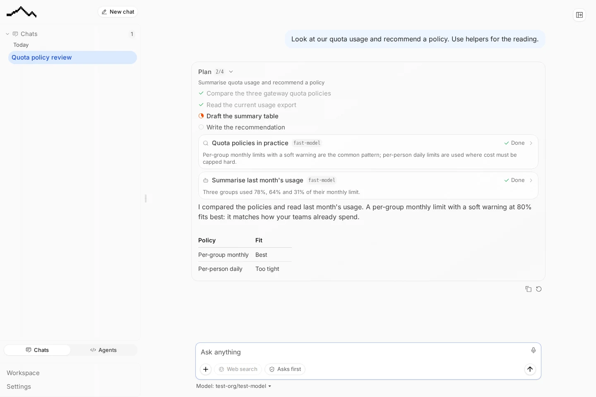

<p align="center">
  <picture>
    <source media="(prefers-color-scheme: dark)" srcset="static/chatui/logo-white.svg">
    
  </picture>
</p>

# Cerea

A self-hosted chat for any OpenAI-compatible endpoint, with knowledge bases,
artifacts, Python in the browser, and coding agents on your own machines.

**The name.** _Cerea_ is a Turinese _modo di dire_: a historic, affectionate
greeting that means both _buongiorno_ and _arrivederci_.



## Cerea and Pystino

Cerea is one half of a pair. Each half solves a different problem, and each
runs on its own:

- **Cerea** (this repository) serves the people using models: the chat, its
  knowledge, artifacts and tools, and **galopin**, which pairs coding agents
  on a person's own machine.
- **[Pystino](https://github.com/paoloviviani/Pystino)** serves the
  organisation paying for them: an OpenAI-compatible gateway with per-user
  and per-group accounting, quotas, PII redaction, model access and an admin
  console.

Cerea alone runs against any OpenAI-compatible endpoint with one shared key.
Pystino alone serves any OpenAI or Anthropic client. Together they are the
intended setup: the chat calls Pystino's `/v1` with each person's own sign-in
token, so spend, quotas and model access follow the person, and the gateway
adds web search, a local document reader and metered coding agents. Below, **the
gateway** means Pystino. The deploy kit in this repository (`kit/`) runs both
together, or the chat alone.

## Features

Unmarked features work against any endpoint; those marked _(Pystino)_ need
the gateway.

- **Chat over any model your endpoint serves**, signed in with OIDC. With
  Pystino each call carries the person's own token, so quotas and billing are
  theirs; without it, every call uses the one key you configure. The stack
  currently signs the chat and the console in against one provider; to combine
  several sources of users, federate them in your own IdP (Keycloak,
  Authentik and the like).
- **Web search** _(Pystino)_, run by the deployment's search backends through
  the gateway, with the backend chosen in Administration → Web search (the
  gateway can also meter provider-side search where a model offers it).
- **File upload and extraction**: PDFs, Office documents (old `.doc` too), images
  and text, read once at upload. With Pystino, extraction goes through the
  gateway and can stay inside your deployment; without it, PDFs and images
  go to an OCR endpoint you name (`CHAT_OCR_BASE_URL`). Scanned PDFs reach a
  model that sees images as page images.
- **Artifacts**: HTML, React and Mermaid previews in sandboxed frames with no
  network access, and generated Word, Excel, PowerPoint and PDF files.
- **Skills and connectors**: built-in skills for office files and data
  analysis ([docs/skills.md](docs/skills.md)), and remote MCP servers as
  connectors ([docs/connectors.md](docs/connectors.md)).
- **Knowledge bases and projects**, shareable with people or groups, with an
  optional project memory ([docs/knowledge.md](docs/knowledge.md)).
- **Python in your browser**, in a WebAssembly sandbox with the scientific and
  office libraries ([docs/pyodide.md](docs/pyodide.md)).
- **Your own models and look**: a global system prompt and private custom
  models (a base model plus a prompt) under Workspace → Customize models, a
  searchable list of every chat at `/chats`, and accent and background palettes
  ([docs/chat.md](docs/chat.md)).
- **The `/code` agents panel**: coding agents on your own machines through
  **galopin**, with a file explorer, scheduled actions (a prompt sent to a
  session on a timetable) and, off by default, a browser terminal. With
  Pystino the agents' model calls are metered like the chat's; without it
  they use opencode's own providers.

## Quick start

The **deploy kit**, the `kit/` directory of this repository, runs the full
stack by default: the chat, Pystino and its console, a bundled identity
provider, a TLS proxy and the add-ons. It is one `compose.yaml`, a documented
`.env.example`, and a `./configure` script. Its installer fetches only that
directory:

```sh
curl -fsSL https://raw.githubusercontent.com/paoloviviani/Cerea/stable/kit/get-kit.sh | sh
cd cerea/kit
./configure
docker compose up -d
```

It also covers a chat-only install, against a central Pystino
(`--preset satellite`) or any OpenAI-compatible endpoint without Pystino
(`--preset generic`). What each shape gives and lacks is in
[docs/deploy.md](docs/deploy.md); the chat also runs without the kit.

## Configuration

Cerea reads its settings from the environment. The ones that matter most:

| Variable                                                                                      | What                                                                        |
| --------------------------------------------------------------------------------------------- | --------------------------------------------------------------------------- |
| `OPENAI_BASE_URL`                                                                             | the OpenAI-compatible API the chat calls (Pystino's `/v1`, or any endpoint) |
| `USE_USER_TOKEN`                                                                              | `true` with Pystino: each call carries the signed-in person's own token     |
| `OPENAI_API_KEY`                                                                              | the one shared key, without Pystino                                         |
| `OPENID_PROVIDER_URL`, `OPENID_CLIENT_ID`, `OPENID_CLIENT_SECRET`                             | the OIDC sign-in                                                            |
| `MONGODB_URL`                                                                                 | conversations, settings and pairing records                                 |
| `CHAT_PG_URL`                                                                                 | PostgreSQL with pgvector, for knowledge-base passages                       |
| `ORIGIN`, `PUBLIC_ORIGIN`                                                                     | the public URL of the chat, and of the whole site                           |
| `CHAT_KNOWLEDGE_ENABLED`, `CHAT_MEMORY_ENABLED`, `CHAT_USAGE_ENABLED`, `CHAT_CONSOLE_ENABLED` | feature switches (`true` or empty)                                          |
| `FETCH_BACKEND`                                                                               | `direct` (default) or `playwright`, the [headless browser](docs/browser.md) |
| `CODE_AGENTS_ENABLED`, `CODE_TERMINAL_ENABLED`                                                | the `/code` panel, and its browser terminal                                 |

The deployment's full, commented list is the kit's `.env.example`; `.env`
here lists every variable the app understands.

## Agents

galopin runs next to the coding agent (opencode) on a person's machine, dials out to Cerea with
its own OIDC credential, and is confirmed by its owner in `/code`. What a
machine allows (the permission ceiling, workspace roots, files, the terminal) is fixed on
the machine at enroll time; the terminal also needs `CODE_TERMINAL_ENABLED=true`
on the deployment. See [docs/code-panel.md](docs/code-panel.md) (operators),
[docs/agent-machines.md](docs/agent-machines.md) (users; the
[reference](docs/agent-machines-reference.md) has the depth) and
[agent/PROTOCOL.md](agent/PROTOCOL.md) (the wire protocol).

## Development

```sh
npm ci                    # also installs the git hooks (husky)
cp .env .env.local        # then set OPENAI_BASE_URL, OPENAI_API_KEY and friends
npm run dev               # http://localhost:5173
npm run check && npm run lint
```

Tests: `npm run test` (server and ssr Vitest projects; on a CPU without AVX point
them at a real MongoDB with `TEST_MONGODB_URL` and add `--no-file-parallelism`),
`npm run test:client` (the component tests, in a real browser), `npx playwright test`
(end to end; `E2E_SKIP_BUILD=1` reuses `build/`) and `cd agent && go test ./...`
(galopin, which needs Go 1.24+). Toolchains, git hooks, every test layer, CI,
releasing and the repository's conventions are in
[CONTRIBUTING.md](CONTRIBUTING.md), which is also the
[Development](https://paoloviviani.github.io/Cerea/development/) page of the
documentation.

**The image** fixes SvelteKit's base path at build time, and builds galopin
too: `docker build --build-arg APP_BASE=/chat -t cerea .`

## Origin

Cerea began as a fork of [huggingface/chat-ui](https://github.com/huggingface/chat-ui),
with its history intact, and is now a hard fork: it does not merge upstream and
carries nothing for upstream's sake. The attribution stays in [NOTICE](NOTICE).

## Documentation

The documentation is a [mkdocs](https://www.mkdocs.org) site built from `docs/`:
[chat](docs/chat.md) · [artifacts](docs/artifacts.md) ·
[pyodide](docs/pyodide.md) · [skills](docs/skills.md) ·
[knowledge](docs/knowledge.md) · [connectors](docs/connectors.md) ·
[agent-machines](docs/agent-machines.md) ·
[agent-machines-reference](docs/agent-machines-reference.md) · [browser](docs/browser.md) ·
[deploy](docs/deploy.md) · [deploy-kit](docs/deploy-kit.md) ·
[configuration](docs/configuration.md) · [chat-admin](docs/chat-admin.md) ·
[code-panel](docs/code-panel.md) · [reference](docs/reference.md) ·
[development](docs/development.md) ·
[PRIVACY](PRIVACY.md). Build it with
`uv run --with-requirements docs/requirements.txt mkdocs build --strict`
(there is no Python project in this repository; the pins are in
`docs/requirements.txt`). Pystino's documentation lives in its own
repository. [docs/source](docs/source) is **upstream chat-ui's**
documentation, kept as upstream wrote it, excluded from the site; parts of it
do not apply to Cerea.

## Contributing, security, licence

See [CONTRIBUTING.md](CONTRIBUTING.md) and, for vulnerabilities,
[SECURITY.md](SECURITY.md). Cerea is Copyright 2026 Paolo Viviani and
licensed under the [Apache License 2.0](LICENSE); [NOTICE](NOTICE) records
that it is based on huggingface/chat-ui, © Hugging Face, and carries the
third-party notices. How this code was written is disclosed in
[AI-DISCLOSURE.md](AI-DISCLOSURE.md).
