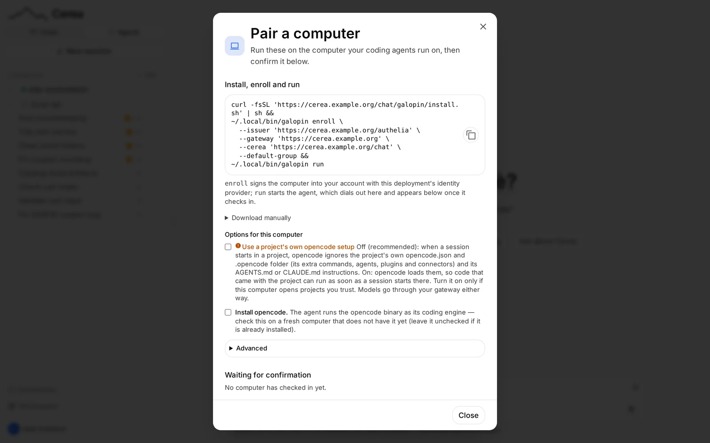
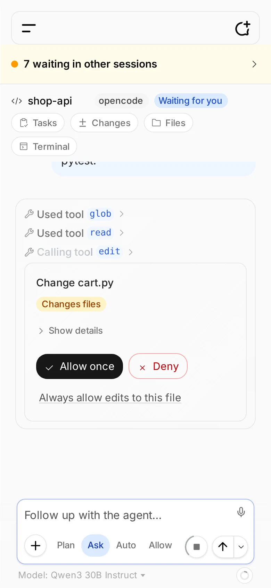

# Agent computers: getting started

!!! info "For users using the Agents panel"

    Pairing your own computer and driving it from the chat. The depth is in the
    [reference](agent-machines-reference.md); **see also**
    [The `/code` panel](code-panel.md), the operator's side of the same feature.

The Agents panel in the sidebar drives coding agents that run **on your own
computer**, not here. Your code stays on it: the agent sends what it needs to the
model through your gateway, and the chat shows you files and changes as you look
at them but keeps no copy. `galopin` is the one binary that makes that possible:
it lives in this repository as `agent/`, and you install it with one line.

None of this works until the deployment has set `CODE_AGENTS_ENABLED=true`; if
you run the deployment, [The `/code` panel](code-panel.md) is the page for that.

## Pair a computer in three steps



The commands on this page use three variables for your deployment's addresses:

```sh
export GATEWAY_BASE_URL=https://cerea.example.org   # the kit: your PUBLIC_ORIGIN
export CEREA_BASE_URL="$GATEWAY_BASE_URL/chat"
export OIDC_ISSUER="$GATEWAY_BASE_URL/authelia"     # bundled Authelia; else your IdP's issuer
```

A satellite or standalone chat on another host sets `CEREA_BASE_URL` to that address.

1. **Sign in to the chat once.** Pairing identifies you by the same account, so
   the chat must have seen you at least once.
2. **Copy the line.** In the sidebar's **Agents** side, click **Pair** (or
   **Pair a device** when the list is empty). The **Pair a computer** dialog
   prints one line for this deployment, with your chat's address and your options filled in. The
   dialog's heading is **Options for this computer**: look
   through them first (see
   [The pairing dialog](agent-machines-reference.md#the-pairing-dialog)), then copy the line.
   One option to know about is **Use a project's own opencode setup**, off by
   default: opencode then ignores a repository's own `opencode.json`, `.opencode`
   folder and `AGENTS.md` or `CLAUDE.md`, so code you did not write cannot add
   commands, agents, plugins or connectors to the session.
3. **Paste it in a terminal on the computer.** Your browser opens to sign in; on
   a computer with no screen it prints a link and a code you can open on your
   phone. The computer then appears in the Agents panel as **Pending**: click the
   green check next to it (its tooltip reads **Confirm this computer**). Only you
   can confirm your computers, and nothing is forwarded to a computer until you
   do. The red cross (**Reject this computer**) refuses one you did not expect to
   see.

A fresh computer also needs opencode, the coding engine galopin runs: tick
**Install opencode** in the dialog and the line installs it first.

That is all. The rest of this page is the panel in brief, what the permission
settings mean and how to update galopin; the dialog's options and everything else
are in the [reference](agent-machines-reference.md).

The command the dialog prints is short, `galopin enroll --cerea <your address>`
(plus the options you chose): the galopin the same line installs asks your Cerea
for its sign-in address, gateway and client id. If the computer already has an
older galopin and you install nothing, open **Using an older galopin?** in the
dialog for the long form with those spelled out.

## Or pair a disposable container

If you would rather not install anything, galopin and opencode come ready in a
container image, with python, node, a C toolchain, git and `gh`. The **Pair a
computer** dialog has a switch at the top: **On this computer** (the one you see
first) or **In a Docker container**. Choose the second and the dialog prints one
`docker run` for the image of your chat's version, with your deployment's
addresses and your options filled in:

```sh
docker run -it --rm \
  --hostname sandbox \
  -v "$PWD":/workspace \
  ghcr.io/paoloviviani/galopin:<version> \
  start \
  --issuer 'https://cerea.example.org/authelia' \
  --gateway 'https://cerea.example.org' \
  --cerea 'https://cerea.example.org/chat' \
  --default-group
```

Run it in a terminal in your project's folder. The container enrolls (it prints a
link and a code to open on any device), then runs the agent, and the computer
appears in the panel as **Pending**: confirm it as for any computer, and add
`/workspace`, your project, as a workspace. Closing the terminal stops the
container.

In this mode the dialog also asks for a **Computer name** (the name the computer
has in the Agents panel; `sandbox` to start with) and offers **Keep the pairing
across restarts**, off by default: a container left alone forgets everything when
it stops, and one that keeps its pairing in a Docker volume does not need pairing
again. The options work as on a computer, except that the opencode install, the
manual download and the goose engine are not offered (the image has what it
needs), and workspace folders you type are paths inside the container.

The image is published with each Cerea release under the same version as the
chat, so the command works once your Cerea's release has published its image. The
container can also enroll by itself from environment variables, and keep its
pairing in a volume you name: see
[Running galopin in a container](agent-machines-reference.md#running-galopin-in-a-container).

## macOS app (menu bar)

**Cerea connector** is a small menu-bar app for a Mac, for someone who just wants Cerea to reach their own files and a browser and would rather not use a terminal. It pairs the Mac as a _connectors-only_ computer (no coding agent), sets up the browser, and keeps galopin running. Everything it needs, including Node for the browser, is inside the app.

**Install it** by pasting this in Terminal (the Mac's own, one line):

```sh
curl -fsSL https://github.com/paoloviviani/Cerea/releases/latest/download/install-cerea-connector.sh | sh
```

It downloads the build for your Mac (Apple Silicon or Intel), checks it, puts **Cerea connector** in `~/Applications`, and opens it. Run the same line again to update; your pairing is kept.

**Or download the zip** from the [releases page](https://github.com/paoloviviani/Cerea/releases/latest): `Cerea-connector-macos-arm64.zip` for Apple Silicon (M1 and later) or `Cerea-connector-macos-amd64.zip` for Intel. Unzip it and drag **Cerea connector** to Applications. The app is not signed with an Apple developer account, so the first time you open it, macOS asks you to confirm. Which steps depend on your macOS version (Apple menu, then **About This Mac**, shows it):

- **macOS 14 (Sonoma) and older:** right-click (or Control-click) the app, choose **Open**, then **Open** again.
- **macOS 15 (Sequoia) and later:** open the app once and dismiss the warning. Then go to **System Settings, Privacy & Security**, scroll to the message about **Cerea connector**, click **Open Anyway**, confirm, and enter your Mac's password. You only do this once.

The install line above avoids this step, because `curl` does not mark what it downloads.

**Using it.** A small icon appears in the menu bar. Its menu shows whether the Mac is _Connected_, _Offline_ or _Not paired_ and the Cerea address, and whether the browser is ready.

| Menu item              | What it does                                                                                                                                                                                |
| ---------------------- | ------------------------------------------------------------------------------------------------------------------------------------------------------------------------------------------- |
| **Pair with Cerea...** | Asks for your Cerea's address, then opens a sign-in page and shows a code to type if it asks. Under **Advanced**, _Pair as a coding-agent computer_ also lets Cerea use coding agents here. |
| **Set up browser**     | Installs galopin's browser runtime and offers it to Cerea. It uses Google Chrome if you have it; otherwise it downloads Chromium, which can take a few minutes.                             |
| **Edit connectors...** | Opens your connectors file (`mcp.json`) in TextEdit, creating an empty one (`{"mcpServers": {}}`) first if there is none. Saved changes are picked up automatically; the format is in [`mcp.json`](local-connectors.md#mcpjson). |
| **Open Cerea**         | Opens the address in your browser.                                                                                                                                                          |
| **Start** / **Stop**   | Starts or stops galopin (Stop lasts until the app is next opened).                                                                                                                          |
| **Start at login**     | Opens the app, and starts galopin, when you log in. On by default.                                                                                                                          |
| **Show logs**          | Opens galopin's log in Console.                                                                                                                                                             |
| **Quit**               | Closes the menu-bar icon. galopin keeps running; use **Stop** first to stop it.                                                                                                             |

**Remove it** with `curl -fsSL https://github.com/paoloviviani/Cerea/releases/latest/download/install-cerea-connector.sh | sh -s -- --uninstall`, then remove the Mac in the Agents panel. See [Removing the macOS app](agent-machines-reference.md#removing-the-macos-app).

## The panel




**Chats | Agents**, at the top of the sidebar under the logo, switches it between
the two, and the button below it follows: **New session** asks for the
computer and the folder (starting on the ones you used last; a **Pair a computer**
dialog opens instead if none is paired yet). The Agents side is a tree: paired
computers, each with its workspaces, each with its sessions.

- **A workspace** is a folder on the computer. Add one by typing its absolute
  path. A computer can be set to refuse folders outside the ones its owner listed.
- **A session** (an "agent") belongs to one workspace. It reads like a chat
  chat, and the composer has the same pills: **mode** (plan, build, and
  whatever the agent offers), **model**, and the **Plan · Ask · Auto · Allow**
  permission selector.
- **The Needs-you inbox** lists, across all your computers, the approvals and
  questions waiting for you, each answerable in place.
- **Changes** opens a pane with the files the session has changed, from git
  (outside a git folder, from the edits the agent made), each with its diff.
- **Cost and context**: the ring in the composer shows how full the model's
  context is, and its popup the session's cost and the latest turn's, as the
  gateway metered them.
- **Connectors**: a session can use your connectors, off until you switch them
  on for it or for a project ([Connectors for an agent](code-panel.md#connectors-for-an-agent)).
- **Files** browses the workspace. It can also edit and save text files (on by default;
  a computer enrolled with `--no-file-write` stays read-only); a file that changed
  on disk since you opened it is a conflict you resolve (reload or overwrite),
  never silently overwritten ([Saving files](agent-machines-reference.md#saving-files)).
- **Slash commands**: type `/` in the composer for the commands the session can
  run, including `/compact`, `/undo`, `/model` and `/new`.
- **Stop** ends a running turn. **Fork from here** on an answer starts a new
  session from that point.
- **The ··· menu** on a computer opens its settings, today the
  [delegate profiles](agent-machines-reference.md#delegate-profiles): which
  model a session's helpers run on.
- **Schedules** (at the foot of the sidebar, the same row as in Chats) send a prompt to one of your sessions on a
  timetable; see [Scheduled actions](agent-machines-reference.md#scheduled-actions).

You need to have signed in to the chat within the last 7 days to use the panel;
your computers keep working meanwhile, the panel just asks you to sign in again
([why](agent-machines-reference.md#the-7-day-sign-in)). To be told when an agent needs you or has finished, turn on
[notifications](notifications.md).

## Permissions

Every session has one **permission setting**, the selector in its composer.
**New sessions start on Ask.**

| Setting   | What it does with a tool call the session has no rule for                                                                         |
| --------- | --------------------------------------------------------------------------------------------------------------------------------- |
| **Plan**  | the agent plans and reads; anything that would change something is refused, with no card                                          |
| **Ask**   | asks you, with an approval card (reading inside the project does not ask)                                                         |
| **Auto**  | each kind of action runs, goes to your reviewer model, or comes to you, as you set in Workspace → Agents                          |
| **Allow** | hands off: everything runs, except a fixed floor (credential files, the computer's own settings, `.git` and CI writes, and loops) |

When a card appears you can **Allow once**, **Always allow (this session)** for
that command, or **Deny**. There are no computer limits: you choose the step per
session, and your rows decide Auto. The fixed floor stays on Allow too, and the
chat cannot loosen it. The full rules, the **Permissions** dialog and the
exceptions are in the [reference](agent-machines-reference.md#permissions).
On Auto, what the reviewer decided is in **Settings → Review log**
([the review log](code-panel.md#the-review-log)).

## Delegating work

A session's model can hand work to other sessions on the same computer, and to
subagents inside its own turn. A computer can have **profiles**, a name and a model
each, so a helper can run on a different model; the model can also run a
**committee** of two or three helpers on one question, or ask a read-only second
opinion. All of it is under the same permissions.
See [Delegating work](agent-machines-reference.md#delegating-work).

## Updating galopin

galopin is a plain binary, so updating it is the install again. On the computer,
re-run the install line from the **Pair a computer** dialog, then restart it:

```sh
curl -fsSL "$CEREA_BASE_URL/galopin/install.sh" | sh
systemctl --user restart galopin     # or stop and start `galopin run`
```

You do **not** enroll again: the computer keeps its pairing, credential and
policy. New panel features that need a newer galopin say so ("update galopin on
that computer"). Details, including macOS, are in
[Updating galopin](agent-machines-reference.md#updating-galopin).

To keep galopin running when the terminal closes, see
[Keeping it running](agent-machines-reference.md#keeping-it-running).

## Removing galopin

To take galopin off a computer (revoke it in Cerea, stop the service, remove the
browser and goose additions, delete the binaries and the configuration
directory), follow the checklist in
[Removing galopin from a computer](agent-machines-reference.md#removing-galopin-from-a-computer).

## Where to go next

| You want…                                                  | Read                                                                                                                                                                                                |
| ---------------------------------------------------------- | --------------------------------------------------------------------------------------------------------------------------------------------------------------------------------------------------- |
| every pairing option and what a computer will refuse       | [The pairing dialog](agent-machines-reference.md#the-pairing-dialog) and [the computer policy](agent-machines-reference.md#the-computer-policy)                                                     |
| terminals, the file explorer, a repo's own config          | [The terminal](agent-machines-reference.md#the-terminal), [the file explorer](agent-machines-reference.md#what-the-file-explorer-may-see), [saving files](agent-machines-reference.md#saving-files) |
| to run it as a service, remove a computer, install by hand | [Installing and running galopin](agent-machines-reference.md#installing-and-running-galopin)                                                                                                        |
| how it works                                               | [How it works](agent-machines-reference.md#how-it-works)                                                                                                                                            |
