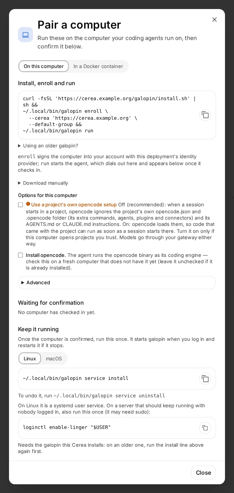
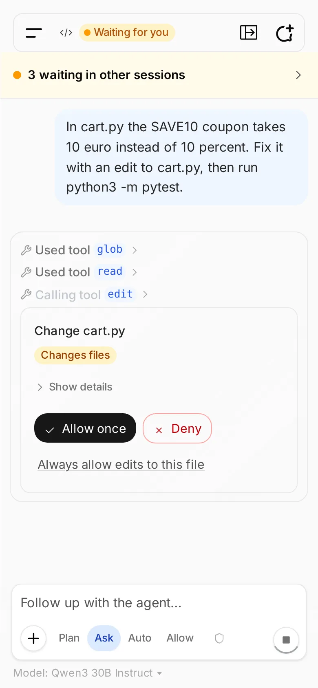
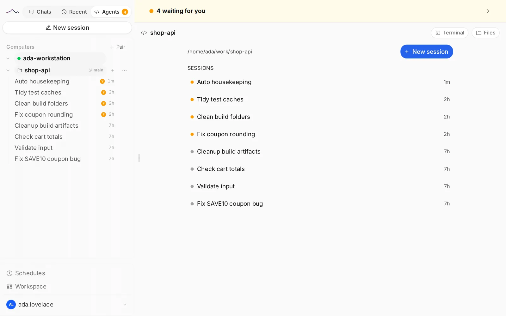

# Agent computers: getting started

!!! info "For users using the Agents panel"

    Pairing your own computer and driving it from the chat. The depth is in the
    [reference](agent-machines-reference.md); **see also**
    [The `/code` panel](code-panel.md), the operator's side of the same feature.

The Agents panel in the sidebar drives coding agents that run **on your own
computer**, not here. Your code stays on it: the agent sends what it needs to the
model through your gateway, and the chat shows you files and changes as you look
at them but keeps no copy. `galopin` is the one binary that makes that possible:
it lives in this repository as `agent/`, and you install it with one line.

None of this works until the deployment has set `CODE_AGENTS_ENABLED=true`; if
you run the deployment, [The `/code` panel](code-panel.md) is the page for that.

## Pair a computer in three steps



The commands on this page use three variables for your deployment's addresses:

```sh
export GATEWAY_BASE_URL=https://cerea.example.org   # the kit: your PUBLIC_ORIGIN
export CEREA_BASE_URL="$GATEWAY_BASE_URL/chat"
export OIDC_ISSUER="$GATEWAY_BASE_URL/authelia"     # bundled Authelia; else your IdP's issuer
```

A satellite or standalone chat on another host sets `CEREA_BASE_URL` to that address.

1. **Sign in to the chat once.** Pairing identifies you by the same account, so
   the chat must have seen you at least once.
2. **Copy the line.** In the sidebar's **Agents** side, click **Pair** (or
   **Pair a device** when the list is empty). The **Pair a computer** dialog
   prints one line for this deployment, with your chat's address and your options filled in. The
   dialog's heading is **Options for this computer**: look
   through them first (see
   [The pairing dialog](agent-machines-reference.md#the-pairing-dialog)), then copy the line.
   One option to know about is **Use a project's own opencode setup**, off by
   default: opencode then ignores a repository's own `opencode.json`, `.opencode`
   folder and `AGENTS.md` or `CLAUDE.md`, so code you did not write cannot add
   commands, agents, plugins or connectors to the session.
3. **Paste it in a terminal on the computer.** Your browser opens to sign in; on
   a computer with no screen it prints a link and a code you can open on your
   phone. The computer then appears in the Agents panel as **Pending**: click the
   green check next to it (its tooltip reads **Confirm this computer**). Only you
   can confirm your computers, and nothing is forwarded to a computer until you
   do. The red cross (**Reject this computer**) refuses one you did not expect to
   see.

A fresh computer also needs a coding engine for galopin to run: opencode by default (goose and
**Mistral Vibe** are the other two, chosen under Advanced as **Coding engine**; see
[the Mistral Vibe engine](agent-machines-reference.md#the-mistral-vibe-engine)). For opencode, tick
**Install opencode** in the dialog and the line installs it first.

That is all. The rest of this page is the panel in brief, what the permission
settings mean and how to update galopin; the dialog's options and everything else
are in the [reference](agent-machines-reference.md).

The command the dialog prints is short, `galopin enroll --cerea <your address>`
(plus the options you chose): the galopin the same line installs asks your Cerea
for its sign-in address, gateway and client id. If the computer already has an
older galopin and you install nothing, open **Using an older galopin?** in the
dialog for the long form with those spelled out.

## Or pair a disposable container

If you would rather not install anything, galopin and opencode come ready in a
container image, with python, node, a C toolchain, git and `gh`. The **Pair a
computer** dialog has a switch at the top: **On this computer** (the one you see
first) or **In a Docker container**. Choose the second and the dialog prints one
`docker run` for the image of your chat's version, with your deployment's
addresses and your options filled in:

```sh
docker run -it --rm \
  --hostname sandbox \
  -v "$PWD":/workspace \
  ghcr.io/paoloviviani/galopin:<version> \
  start \
  --issuer 'https://cerea.example.org/authelia' \
  --gateway 'https://cerea.example.org' \
  --cerea 'https://cerea.example.org/chat' \
  --default-group
```

Run it in a terminal in your project's folder. The container enrolls (it prints a
link and a code to open on any device), then runs the agent, and the computer
appears in the panel as **Pending**: confirm it as for any computer, and add
`/workspace`, your project, as a workspace. Closing the terminal stops the
container.

In this mode the dialog also asks for a **Computer name** (the name the computer
has in the Agents panel; `sandbox` to start with) and offers **Keep the pairing
across restarts**, ticked by default: a container that keeps its pairing in a
Docker volume does not need pairing again, while an unticked one forgets
everything when it stops (a throwaway container). The options work as on a computer, except that the opencode install, the
manual download and the goose and Mistral Vibe engines are not offered (the image has what it
needs), and workspace folders you type are paths inside the container.

The image is published with each Cerea release under the same version as the
chat, so the command works once your Cerea's release has published its image. The
container can also enroll by itself from environment variables, and keep its
pairing in a volume you name: see
[Running galopin in a container](agent-machines-reference.md#running-galopin-in-a-container).

### On a Mac, without Docker

On an Apple-silicon Mac (M1 or later) with macOS 26, Apple's own
[`container`](https://github.com/apple/container) tool runs the same image natively,
with no Docker Desktop. The image is multi-arch since Cerea 0.54.1.

1. Install `container` from its [releases page](https://github.com/apple/container/releases)
   (the signed `.pkg`), then start its service once:

   ```sh
   container system start
   ```

2. Create a volume so the pairing survives restarts (once):

   ```sh
   container volume create galopin-home
   ```

3. In **Pair a computer**, turn on **In a Docker container** and copy the command. Replace
   `docker` with `container`, `--hostname` with `--name`, and add the volume. Run it from
   the folder you want the agent to work in:

   ```sh
   container run -it --rm --name my-mac-sandbox \
     -v galopin-home:/home/galopin \
     -v "$PWD":/workspace \
     ghcr.io/paoloviviani/galopin:<version> \
     start --issuer ... --gateway ... --cerea ... --default-group
   ```

   It prints a link and a code: open the link on any device and sign in. Then confirm the
   computer in the **Agents** panel and add `/workspace` as a workspace.

4. To start it again later, run the same command **without `start` and the flags after
   it**: the paired volume starts the agent by itself. To forget the pairing:
   `container volume rm galopin-home`.

The flags of `container` can change between its releases; `container run --help` shows
yours. Details: [Running galopin in a container](agent-machines-reference.md#running-galopin-in-a-container).

## macOS app (menu bar)

**Cerea connector** is a small menu-bar app for a Mac, for someone who just wants Cerea to reach their own files and a browser and would rather not use a terminal. It pairs the Mac as a _connectors-only_ computer (no coding agent), sets up the browser, and keeps galopin running. Everything it needs, including Node for the browser, is inside the app.

**Install it** by pasting this in Terminal (the Mac's own, one line):

```sh
curl -fsSL https://github.com/paoloviviani/Cerea/releases/latest/download/install-cerea-connector.sh | sh
```

It downloads the build for your Mac (Apple Silicon or Intel), checks it, puts **Cerea connector** in `~/Applications`, and opens it. Run the same line again to update; your pairing is kept.

**Or download the zip** from the [releases page](https://github.com/paoloviviani/Cerea/releases/latest): `Cerea-connector-macos-arm64.zip` for Apple Silicon (M1 and later) or `Cerea-connector-macos-amd64.zip` for Intel. Unzip it and drag **Cerea connector** to Applications. The app is not signed with an Apple developer account, so the first time you open it, macOS asks you to confirm. Which steps depend on your macOS version (Apple menu, then **About This Mac**, shows it):

- **macOS 14 (Sonoma) and older:** right-click (or Control-click) the app, choose **Open**, then **Open** again.
- **macOS 15 (Sequoia) and later:** open the app once and dismiss the warning. Then go to **System Settings, Privacy & Security**, scroll to the message about **Cerea connector**, click **Open Anyway**, confirm, and enter your Mac's password. You only do this once.

The install line above avoids this step, because `curl` does not mark what it downloads.

**Using it.** A small icon appears in the menu bar. Its menu shows whether the Mac is _Connected_, _Offline_ or _Not paired_ and the Cerea address, and whether the browser is ready.

| Menu item              | What it does                                                                                                                                                                                                                                                                                                                                     |
| ---------------------- | ------------------------------------------------------------------------------------------------------------------------------------------------------------------------------------------------------------------------------------------------------------------------------------------------------------------------------------------------ |
| **Pair with Cerea...** | Asks for your Cerea's address, then opens a sign-in page and shows a code to type if it asks. Under **Advanced**, _Pair as a coding-agent computer_ also lets Cerea use coding agents here. When pairing as a coding-agent computer and you can bill to several groups, a list appears after sign-in to pick one, with your default preselected. |
| **Set up browser**     | Installs galopin's browser runtime and offers it to Cerea. It uses Google Chrome if you have it; otherwise it downloads Chromium, which can take a few minutes.                                                                                                                                                                                  |
| **Edit connectors...** | Opens your connectors file (`mcp.json`) in TextEdit, creating an empty one (`{"mcpServers": {}}`) first if there is none. Saved changes are picked up automatically; the format is in [`mcp.json`](local-connectors.md#mcpjson).                                                                                                                 |
| **Open Cerea**         | Opens the address in your browser.                                                                                                                                                                                                                                                                                                               |
| **Start** / **Stop**   | Starts or stops galopin (Stop lasts until the app is next opened).                                                                                                                                                                                                                                                                               |
| **Start at login**     | Opens the app, and starts galopin, when you log in. On by default.                                                                                                                                                                                                                                                                               |
| **Show logs**          | Opens galopin's log in Console.                                                                                                                                                                                                                                                                                                                  |
| **Quit**               | Closes the menu-bar icon. galopin keeps running; use **Stop** first to stop it.                                                                                                                                                                                                                                                                  |

**Remove it** with `curl -fsSL https://github.com/paoloviviani/Cerea/releases/latest/download/install-cerea-connector.sh | sh -s -- --uninstall`, then remove the Mac in the Agents panel. See [Removing the macOS app](agent-machines-reference.md#removing-the-macos-app).

Add `--purge` to also delete the pairing and logs. That removes `~/Library/Application Support/galopin`, which a manual command-line install of galopin on the same Mac shares, so that install is unpaired too.

## The panel




**Chats | Recent | Agents**, at the top of the sidebar under the logo, switches it
between them (**Recent** mixes chats and sessions, newest first; see
[Chat](chat.md)), and the button below it follows: **New session** asks for the
computer and the folder (starting on the ones you used last; a **Pair a computer**
dialog opens instead if none is paired yet). The Agents side is a tree: paired
computers, each with its workspaces, each with its sessions.

- **A workspace** is a folder on the computer. Add one by typing its absolute
  path. A computer can be set to refuse folders outside the ones its owner listed.
- **A session** (an "agent") belongs to one workspace. It reads like a chat
  chat, and the composer has the same pills: **mode** (plan, build, and
  whatever the agent offers), **model**, and the **Plan · Ask · Auto · Allow**
  permission selector.
- **The Needs-you inbox** lists, across all your computers, the approvals and
  questions waiting for you, each answerable in place.
- **Changes** opens a pane with the files the session has changed, from git
  (outside a git folder, from the edits the agent made), each with its diff.
- **Cost and context**: the ring in the composer shows how full the model's
  context is, and its popup the session's cost and the latest turn's, as the
  gateway metered them.
- **Connectors**: a session can use your connectors, off until you switch them
  on for it or for a project ([Connectors for an agent](code-panel.md#connectors-for-an-agent)).
- **A workspace screen** opens when you click a workspace: its sessions, a
  **New session** button, and **Terminal** and **Files** at the top right,
  with no session needed. The terminal starts in the workspace folder and the
  file browser is rooted there; a button you do not see is one the computer, its
  policy or the deployment does not offer.

  

- **Files** browses the workspace. It can also edit and save text files (on by default;
  a computer enrolled with `--no-file-write` stays read-only, and the browser says so); a file that changed
  on disk since you opened it is a conflict you resolve (reload or overwrite),
  never silently overwritten ([Saving files](agent-machines-reference.md#saving-files)).
  **Upload** (or drop files or whole folders on the list) adds files of any
  type, up to 200 MB each (a folder: up to 5,000 files and 2 GB), to the folder
  you last opened, in chunks with progress and a Cancel; it follows the same rules
  as saving, asks once "N files already exist: Replace all / Skip existing /
  Cancel" before overwriting, and needs a recent galopin. **Download** (an icon on
  a file's row, or a button in the open file) saves any file up to 500 MB, and
  **Download as zip** (on a folder) a whole folder up to 2 GB, with only reading
  needed; deny-listed files and symlinks are left out of a zip and listed in its
  `SKIPPED.txt`.
- **Slash commands**: type `/` in the composer for the commands the session can
  run, including `/compact`, `/undo`, `/model` and `/new`.
- **Stop** ends a running turn. **Fork from here** on an answer starts a new
  session from that point.
- **The ··· menu** on a computer opens its settings, today the
  [delegate profiles](agent-machines-reference.md#delegate-profiles): which
  model a session's helpers run on.
- **Schedules** (at the foot of the sidebar, the same row as in Chats) send a prompt to one of your sessions on a
  timetable; see [Scheduled actions](agent-machines-reference.md#scheduled-actions).

You need to have signed in to the chat within the last 7 days to use the panel;
your computers keep working meanwhile, the panel just asks you to sign in again
([why](agent-machines-reference.md#the-7-day-sign-in)). To be told when an agent needs you or has finished, turn on
[notifications](notifications.md).

## Permissions

Every session has one **permission setting**, the selector in its composer.
**New sessions start on Ask.**

| Setting   | What it does with a tool call the session has no rule for                                                                         |
| --------- | --------------------------------------------------------------------------------------------------------------------------------- |
| **Plan**  | the agent plans and reads; anything that would change something is refused, with no card                                          |
| **Ask**   | asks you, with an approval card (reading inside the project does not ask)                                                         |
| **Auto**  | each kind of action runs, goes to your reviewer model, or comes to you, as you set in Workspace → Agents                          |
| **Allow** | hands off: everything runs, except a fixed floor (credential files, the computer's own settings, `.git` and CI writes, and loops) |

When a card appears you can **Allow once**, **Always allow (this session)** for
that command, or **Deny**. There are no computer limits: you choose the step per
session, and your rows decide Auto. Allow never asks: only the computer's own files and
what its owner refused there are refused, and the chat cannot loosen that. On
Ask and Auto a fixed floor still comes to you. The full rules, the **Permissions** dialog and the
exceptions are in the [reference](agent-machines-reference.md#permissions).
On Auto, what the reviewer decided is in **Settings → Review log**
([the review log](code-panel.md#the-review-log)).

## Delegating work

A session's model can hand work to other sessions on the same computer, and to
subagents inside its own turn. A computer can have **profiles**, a name and a model
each, so a helper can run on a different model; the model can also run a
**committee** of two or three helpers on one question, or ask a read-only second
opinion. All of it is under the same permissions.
See [Delegating work](agent-machines-reference.md#delegating-work).

## Claude Code with your own subscription

Claude Code can run as a session in the Agents panel, signed in to **your** Claude
subscription on **your** computer. Cerea drives it through galopin's ACP backend:
you send prompts, see answers, tool calls and diffs, approve actions and use slash
commands. Model calls go straight from Claude Code to Anthropic: they do not pass
through the gateway and do not use your Cerea quota. This covers agent sessions
only; Anthropic models in the chat still need an Anthropic provider in the gateway.

### Requirements

- A computer paired with Cerea as an **agent machine**, with the galopin CLI. The
  macOS menu-bar app pairs connectors only, so it is not enough.
- galopin **0.54.2 or newer**: `curl -fsSL <your-cerea>/galopin/install.sh | sh -s -- --upgrade`.
- **Node 22 or newer.**
- Claude Code installed and signed in with your subscription (run `claude` once
  and sign in).

### Setup

1. Install the ACP adapter, pinning a version rather than taking the newest:

   ```sh
   npm i -g @agentclientprotocol/claude-agent-acp@<version>
   ```

   `npm view @agentclientprotocol/claude-agent-acp time` lists versions by date; a
   version a few weeks old is a reasonable choice.

2. Stop any galopin already running, then try it in the foreground:

   ```sh
   galopin run --backend acp --acp-command "claude-agent-acp"
   ```

3. In Cerea: **Agents**, then the computer, then **New session** in a workspace.

4. To keep it running (galopin **0.54.3 or newer**), install it as a service with
   the same flags:

   ```sh
   galopin service install -- --backend acp --acp-command "$(command -v claude-agent-acp)"
   ```

   Use the **full path** of `claude-agent-acp`: a service does not see the PATH of
   your shell, nvm or Homebrew. Check with `galopin service status`.

### What works

- Prompts, streamed answers, tool calls, diffs, and approval cards. Approvals
  follow the session's mode (Plan, Ask, Auto, Allow).
- Slash commands: your `.claude/commands`, those from plugins and skills, and the
  built-ins that do not need the terminal.
- Sessions started in the Claude Code terminal show up in Cerea's list and open
  with their history. Large sessions load page by page.
- Image and file attachments, where Claude Code accepts them.

### Limits

- **The model and token usage are not shown in Cerea:** the adapter does not report
  them. They count against your subscription, not Cerea.
- **No reverting turns, no sub-sessions shown as separate sessions, no prompting
  mid-turn.** The ACP protocol does not have them.
- **"Always allow"** on an approval stays a galopin rule on that computer. It is not
  written into Claude Code's own settings.
- **galopin's deny list** (keys, credentials) protects what Cerea shows and sends.
  Claude Code's own file access follows its own permission rules: set those in
  Claude Code if you want the same protection.
- **Terminal-only commands** like `/login`, `/config` and `/model` are not available
  from Cerea.

### Through the gateway instead of a subscription

To bill a group and apply the privacy pipelines, point Claude Code at the gateway
with a gateway key instead of a Claude login. Set these for the galopin process
(your shell, or the service's environment):

```sh
ANTHROPIC_BASE_URL=https://<your-cerea>
ANTHROPIC_AUTH_TOKEN=<a gateway key>
ANTHROPIC_MODEL=<a model id the gateway serves>
```

Claude Code adds `/v1/messages` itself, so the base URL is the gateway's origin
without `/v1`.

### Terms of use

Anthropic's terms restrict third-party products that offer sign-in with a Claude
account, or use its rate limits, unless Anthropic approves them. Here each user
runs the official Claude Code with their own subscription on their own computer,
and Cerea never holds or relays the credentials. Check Anthropic's current terms
before offering this to an organisation; the gateway route has no such question.

More detail: [Running Claude Code over ACP](agent-machines-reference.md#running-claude-code-over-acp).

## Updating galopin

galopin is a plain binary, so updating it is the install again. On the computer,
re-run the install line from the **Pair a computer** dialog, then restart it:

```sh
curl -fsSL "$CEREA_BASE_URL/galopin/install.sh" | sh
systemctl --user restart galopin     # or stop and start `galopin run`
```

The panel offers this only when galopin itself changed: a computer is flagged when
its galopin is older than the last Cerea release that changed galopin
(`agent/LAST_CHANGED`), so a Cerea release without galopin changes flags nothing.
A galopin older than the oldest one Cerea still supports (`MIN_SUPPORTED_GALOPIN`
in `src/lib/utils/appVersion.ts`, raised by hand when support for an older
galopin is dropped) gets a stronger "update needed" warning. When preparing a
release commit, run `scripts/release/galopin-last-changed.sh X.Y.Z`; `release.sh`
checks it.

You do **not** enroll again: the computer keeps its pairing, credential and
policy. New panel features that need a newer galopin say so ("update galopin on
that computer"). Details, including macOS, are in
[Updating galopin](agent-machines-reference.md#updating-galopin).

## Keep it running

`galopin run` stops when its terminal closes. The last step of the **Pair a
computer** dialog, **Keep it running**, gives one command for it:

```sh
~/.local/bin/galopin service install
```

It starts galopin when you log in and restarts it if it stops. It is optional:
without it, `galopin run` works the same while its terminal is open, and
`galopin launch` needs neither. To remove it, run `galopin service uninstall`;
`galopin service status` shows whether it runs and where its log is, and
`galopin status` says how galopin is kept running on that computer (the service,
a terminal, the Mac app or a container). The Agents panel shows the same under each
computer's name, which opens to the way to stop or remove it. On a Linux server that should keep running with nobody logged
in, also run `loginctl enable-linger "$USER"` (it may need sudo). In Docker the
dialog always prints `docker run -d --restart unless-stopped …` instead (with
the pairing box unticked it says to tick it and run the first command again
first). Run the first, interactive command as printed, without `-d` or
`--restart`: a container that cannot sign in would restart in a loop. A galopin
from before this command needs updating first. Details:
[Keeping it running](agent-machines-reference.md#keeping-it-running).

## Upgrading galopin

An existing galopin (and the coding engine it runs) upgrades in one step that
stops it cleanly, backs up its state, installs the build and engine version your
Cerea pins, and starts it again. Enrollment and settings are kept: nothing is
paired or enrolled again. The **Pair a computer** dialog and the computer's card in the
Agents panel show the line when that computer's galopin is older than your Cerea:

```sh
curl -fsSL "$CEREA_BASE_URL/galopin/install.sh" | sh -s -- --upgrade
```

**From Cerea.** When a computer's galopin is older than your Cerea and the computer is
online, its card in the Agents panel shows an **Upgrade** button, so nothing has to be
typed on the computer. It asks first ("galopin goes from X to Y; galopin restarts on this
computer and it goes offline for about a minute"), then galopin runs the same path as
`galopin upgrade --yes` (below), and the card shows "Upgrading…", then "Updated to vX" when
the computer reconnects at the new version. If it reconnects with the old version, or does
not come back within about five minutes, the card says the upgrade did not complete and
where the log is (`<galopin config dir>/backups/upgrade-<date>.log` on that computer, in
`~/.config/galopin` on Linux). Only the computer's owner sees the button.

The button appears only where an in-place upgrade can work: galopin runs as its
`galopin` systemd user unit, `systemd-run` is available, and the computer has not opted
out. Everywhere else the card shows the instructions that fit instead: on a Mac with the
Cerea connector app, upgrade through the app's installer; in Docker, `docker pull` the new
image and recreate the container; a galopin started by hand (or without `systemd-run`),
or one that opted out, uses the install command above in a terminal outside galopin; a
galopin from before this feature reports nothing and also shows the command.

The button is a **remote code path**: it makes the computer download and run the installer
Cerea serves, which is what you would paste by hand. It is on by default, **except** on a
computer that denies both the terminal and the command shell (`--no-terminal` and
`--no-command-shell`): its owner expects Cerea cannot run code there, so remote upgrade is
off until it is enrolled with `--allow-remote-upgrade`. To keep Cerea from upgrading any
computer, enroll it with `--no-remote-upgrade` (or run
`galopin policy set --no-remote-upgrade`, which takes effect within seconds, no restart);
`galopin enroll --allow-remote-upgrade` turns it back on. The command above still works
either way. A Mac where `galopin service install` set galopin up under launchd shows
`galopin service uninstall`, the install command, then `galopin service install`.

or, from a galopin new enough to have it, `galopin upgrade` (it downloads that
installer from the Cerea the computer is enrolled with, shows what it will do and asks
first; `--yes` skips the question, `--show` prints the installer and runs nothing; it
only fetches over https, or http on the computer itself, and refuses a redirect to
another site). In order, `--upgrade`:

1. **Checks** that the computer is enrolled (galopin's `credentials.json` in its
   configuration directory, `~/.config/galopin` on Linux). Without one it stops with
   "nothing to upgrade, run the normal install". It also finds out what runs galopin.
2. **Downloads and verifies** the new galopin and the engine **before** stopping anything,
   so a bad download or checksum changes nothing.
3. **Stops** galopin: the `galopin` systemd user unit if it is running (the unit's own
   `~/.local/bin/galopin` is the one upgraded). A `galopin run` you started by hand is not
   stopped unless you add `--stop`, which sends SIGTERM to your own `galopin run` whose
   binary is the one being upgraded, and to nothing else. On a Mac the Cerea connector app
   owns galopin: upgrade through its installer, and the script says so. Inside a Docker
   container it prints the `docker pull` and recreate steps instead.
   If the upgrade is started from **inside galopin** (Cerea's own terminal, or anything in
   the unit's cgroup), stopping galopin would close it half way, so with the systemd unit
   the installer re-runs itself as a transient `systemd-run --user` unit, prints
   "Upgrade continues in the background; this terminal will close when galopin restarts",
   and logs to `<galopin config dir>/backups/upgrade-<date>.log`; without `systemd-run`,
   or for a foreground `galopin run`, it refuses and asks for a terminal outside galopin.
   `galopin upgrade --yes` run by an agent takes the same path.
4. **Backs up** galopin's configuration and state (not the browser's profile and
   downloads, nor opencode's tools and temporary files), the binary being replaced and,
   for the opencode engine, opencode's database (`~/.local/share/opencode/opencode.db`
   with its `-wal` and `-shm` files), into
   `<galopin config dir>/backups/pre-upgrade-<date>/` (the last three are kept), and
   prints the path. opencode 2 migrates a 1.x database in place, so keep this until you
   are sure of the new engine.
5. **Installs** the new galopin (each binary is copied beside its place and renamed into
   it; the previous galopin stays as `galopin.prev`). If the new galopin does not run,
   the old one is put back at once. For the opencode engine it installs the opencode
   version your Cerea pins when galopin's own copy in `~/.opencode/bin` is older or
   missing (never a downgrade, unless you pass `--with-opencode`); goose the same way for
   the goose engine, and the pinned Mistral Vibe the same way for the Vibe engine. An opencode you installed elsewhere, such as with npm, is left alone,
   with a note on how to update it.
6. **Refreshes** the browser runtime when you set it up (`galopin browser setup`) and
   checks the credential (`galopin auth status`).
7. **Starts** the systemd unit again (when it was running, is enabled, or an earlier
   failed run stopped it), and prints the old and new versions.

If the installer is interrupted or fails after galopin was stopped and before the new
galopin is in place, it starts the old one again. After that, it prints how to roll back:
put the old binary (kept in the backup, and as `galopin.prev`) back over `galopin`,
restore the opencode database from the backup, and only then start galopin. Running the
upgrade again is safe. The installer is one function called on its last line, so a
download cut short does nothing.

The panel offers the upgrade line for a computer whose galopin reports an older version
than your Cerea. galopin's version is the Cerea release it was built from (`galopin
version`); a galopin built from source **without** the release's `-ldflags "-X
main.agentVersion=X.Y.Z"` reports `0.1.0`, as every galopin from before this did, and is
therefore always offered the upgrade. Containers are not offered it (pull the image).

## Removing galopin

To take galopin off a computer (revoke it in Cerea, stop the service, remove the
browser and goose additions, delete the binaries and the configuration
directory), follow the checklist in
[Removing galopin from a computer](agent-machines-reference.md#removing-galopin-from-a-computer).

## Where to go next

| You want…                                                  | Read                                                                                                                                                                                                |
| ---------------------------------------------------------- | --------------------------------------------------------------------------------------------------------------------------------------------------------------------------------------------------- |
| every pairing option and what a computer will refuse       | [The pairing dialog](agent-machines-reference.md#the-pairing-dialog) and [the computer policy](agent-machines-reference.md#the-computer-policy)                                                     |
| terminals, the file explorer, a repo's own config          | [The terminal](agent-machines-reference.md#the-terminal), [the file explorer](agent-machines-reference.md#what-the-file-explorer-may-see), [saving files](agent-machines-reference.md#saving-files) |
| to run it as a service, remove a computer, install by hand | [Installing and running galopin](agent-machines-reference.md#installing-and-running-galopin)                                                                                                        |
| how it works                                               | [How it works](agent-machines-reference.md#how-it-works)                                                                                                                                            |
