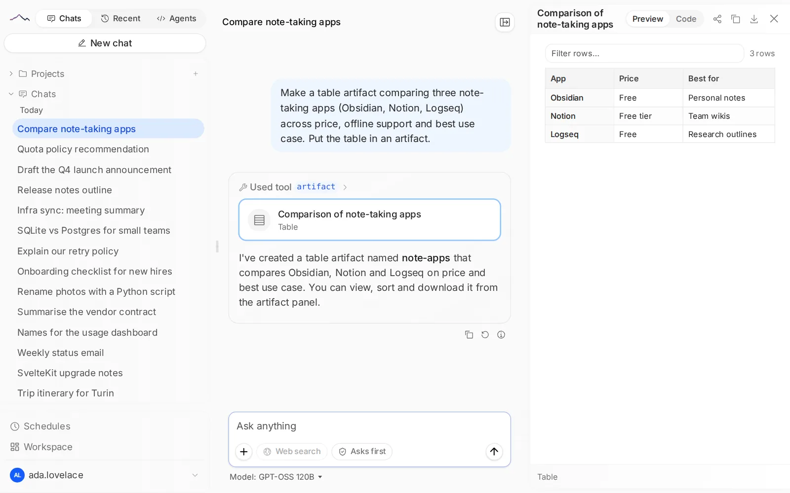
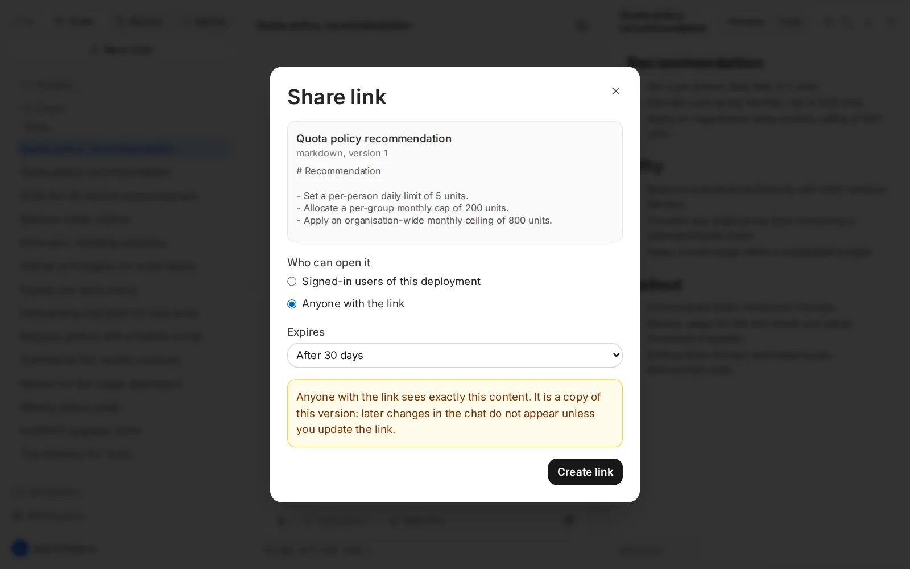

# Artifacts

!!! info "For everyone"

    What the assistant can hand you besides text: previews, documents and files, and where to find them again.

An **artifact** is a substantial, self-contained thing the assistant makes for
you, an app, a document, a diagram, a table, a report or an image, shown in
a side panel beside the chat rather than buried in the transcript.
There are two kinds: **text artifacts**, which the model writes, and **file
artifacts**, which a Python run produces.

## Text artifacts

The model writes an artifact when the content is worth keeping apart from the
answer. The kinds are:

| Kind            | Shown as                               |
| --------------- | -------------------------------------- |
| **HTML**        | a live page, in a sandboxed frame      |
| **React**       | a live component, in a sandboxed frame |
| **Mermaid**     | a rendered diagram                     |
| **SVG**         | a preview                              |
| **Markdown**    | rendered text                          |
| **Table** (CSV) | a grid                                 |
| **Slides**      | a slide deck you can present           |
| **Code**        | source, not previewed                  |

Previews run in **sandboxed frames with no network access**: no cookies, no
storage, no requests out, no remote images. See
[what rendered artifacts can do](pyodide.md#what-rendered-artifacts-can-do).

**Every change is a new version.** When you ask for an edit, the model can
rewrite the artifact whole, or send targeted replacements that are applied to
the latest version, so it does not re-emit a long document to change a
sentence. The panel keeps the history and lets you move between versions.

Whether a model makes artifacts follows the model's setting in the
**Workspace → Models** tab: on for a model that can call tools unless the
setting says otherwise.

### Slides

A **slides** artifact is a deck the assistant writes as HTML slides and Cerea
shows with [reveal.js](https://revealjs.com), inside the same sandboxed frame as
every other preview, so it works offline. The assistant designs the slides
freely (colours, grids, diagrams); Cerea supplies the controls. Ask for "slides
on X" and, if it is not clear whether you want something to present here or a
PowerPoint file to edit, the assistant asks first.

- **Step through it** with the arrows under the slides, or the arrow keys, or swipe. The counter shows where you are; **Esc** (or **O**) shows an overview.
- **Present** takes the deck full screen (on a phone it fills the window).
- **Speaker notes** show in a drawer under the slide (the notes button, or **N** or **S**). Cerea cannot open a separate speaker window, because the frame blocks pop-ups.
- **Formulas.** LaTeX written between dollar signs (`$x^2$`, `$$...$$`) or `\(...\)` and `\[...\]` is typeset, including matrices, `cases`, `\newcommand` and chemistry with `\ce{}`. A price such as `$5 and $10` stays text. A formula that cannot be read shows as its source, in red, and the deck carries on.
- **PDF.** The **PDF** button makes the best PDF your deployment can: where an administrator runs the [page renderer](browser.md) (the stack's `fetch` profile) it downloads a PDF with real text you can select, one page per slide. Without it, the button opens the deck in a new tab in print layout, ready for your browser's **Print** dialog (choose _Save as PDF_; turn on background graphics to keep the colours). The small arrow beside it lists the others: print with speaker notes on their own pages, and **Download PDF as pictures**, made in your browser with no server at all, where the text cannot be selected. Vertical slides get a page each.
- **Download** in the panel header saves the slides' source.
- **Look.** Nothing is imposed. If your organisation has set a brand colour, font or logo, the assistant can use them. You can ask for a theme: **Cerea**, **Cerea dark**, or reveal.js's **white**, **black**, **simple**, **moon**, **solarized** or **dracula**.
- **What is tidied away.** A deck's own scripts, event handlers (`onclick`), remote images and styles, and `<link>`, `<iframe>`, `<object>` and similar are taken out before it is shown, in HTML decks and in HTML inside Markdown ones. That is tidying, not the safeguard: the frame itself (no access to Cerea, no network) is what keeps a deck contained.
- For a quick plain deck the assistant can write Markdown instead (slides separated by `---`).

An administrator can set the brand colour, font and logo under
[Administration → Assistant](chat-admin.md#slides), off until set. A slides
artifact cannot be opened in PowerPoint: ask for a [PowerPoint file](office.md)
when you need one to edit.

## File artifacts

A file produced by Python in the [browser sandbox](pyodide.md) (a spreadsheet, a
PDF, a Word document, a chart) is a file artifact. The card under the output
looks like a text artifact's: name, kind and size, with **Download** and **Open
in panel**.

- **Versions follow the name.** When you ask for a change and the assistant writes `report.pdf` again, that is v2 of the same artifact; an identical file adds nothing.
- **A card always opens what it showed.** An older card in the chat opens the version it produced at the time, even after later versions exist; the panel moves you between versions.
- **Deleting older versions** works the same way as for text artifacts (see [Deleting older versions](#deleting-older-versions)); the stored files are freed.
- **Produced files are kept for 30 days** by default (an administrator sets the period, or no expiry, under [Administration → Storage](chat-admin.md#storage)), per user, and survive reloads and
  other devices, so a chart or a document is still there the next day, however the assistant ran the code.

### Images

A **raster image** a run produces (PNG, JPEG, GIF or WebP) is shown **inline**
under its card, without a click. Charts the assistant draws arrive this way, as
`figure-1.png` and so on (or under the name you asked for; see
[Charts](pyodide.md#charts)). **SVG is never shown inline**, because an
SVG can carry script, and neither are formats a browser may not decode; those
keep the click-to-preview and the download.

## Deleting older versions

!!! info "For everyone"

    You can free the history of an artifact without deleting the chat.

**Delete older versions** (the trash button at the bottom of the artifact panel, on your own chats) deletes every version of this artifact except the current one. It asks first and says how many versions will go; it cannot be undone. Afterwards it reports, for example, _2 versions deleted; 1 kept because they are shared._

- **A version with an active share link is never deleted**, whatever the link's audience: not revoked and not expired. Revoke the link (or let it expire) first if you want that version gone. Only a link's owner can do this, since only the owner of a chat can delete its versions.
- **The numbers do not change.** The remaining versions keep their numbers (the current one may be _v3_ with _v1_ kept because it is shared), and the version arrows step over the deleted ones.
- **Old cards in the chat** that pointed at a deleted version say _This version was deleted_ and offer **Open the current version** instead of breaking.
- **Files:** a file version's stored bytes are freed, unless another version or stored file still uses the same content.
- **Text:** the messages of the chat are not changed (a text artifact is written into them). The deleted version is marked on the chat and no longer shown or counted.

An administrator can also limit how many versions of each artifact the deployment keeps, under [Administration → Storage](chat-admin.md#versions-per-artifact): older versions beyond that number are deleted by the hourly sweep, with the same exception for shared versions. It is off (unlimited) by default.

## The Artifacts panel

The chat's menu opens the **Artifacts** panel in the same side pane the
previews use, so the list sits beside the chat instead of replacing it. It lists
everything this chat produced, in the order it appeared: the text
artifacts, and the files the assistant's code wrote. Each row opens the
artifact in the panel with its versions and preview; each file has its own
**Download**, and the list has a reload button.

The panel is **per chat**: it lists the open chat's files, not other
chats', and files older than the retention period are gone.

## The Artifacts tabs

The panel shows one chat. To find something the assistant made in an
older chat, use an **Artifacts** tab:

- a **project's page** has an **Artifacts** tab next to **Chats** and
  **Settings** (`/projects/<id>?tab=artifacts`): what the assistant made in
  your own chats of that project;
- the **Chats** page (`/chats`) has an **Artifacts** tab (`?tab=artifacts`):
  the same for chats that are in no project.

Each row is one artifact, newest first: its name, what kind it is, its latest
version and how many versions there are, the chat it came from and when. The
name and the chat open that chat with the artifact in the side panel; the
download button saves the latest version. A box above the list filters by
name, and more rows load as you scroll. Files you attached to a message are
not listed, only what the assistant made: text artifacts, files from its code
and Office documents from the document tools.

The tab lists **only your own chats**. In a shared project, the artifacts of
a colleague's chats are not listed and not counted. There is nothing to delete
on the tab: an artifact belongs to its chat and goes when you delete the chat
(or after the retention period, for files); to free its history, open it and use
[Delete older versions](#deleting-older-versions).

## Sharing an artifact

!!! info "For everyone"

    You can give anyone a link to one artifact, without sharing the chat.

**Share link…** in the artifact panel's header makes a public link to the
artifact you are looking at. The link shows a **frozen copy of that version**:
later changes in the chat do not appear unless you press **Update to latest
version**. It never includes the chat, the prompt or any other artifact.

The dialog shows a preview, and says plainly who will see it: _Anyone with the
link sees exactly this content_, or, for the default audience, _Any signed-in
user of this deployment with the link sees exactly this content_. You choose:

- **Who can open it:** signed-in users of this deployment (the default), or anyone with the link.
- **When it expires:** after 7, 30 or 90 days, or never. Expired links stay listed, and you can set a new period.
- **Copy link.** For safety only a hash of the link is stored, so the link is shown **once**, when you make it. Later the dialog manages it (audience, expiry, **Update to latest version**, **Revoke**) and **Replace link** makes a new link and retires the old one.

**Settings → Shared links** lists your links (artifact, chat, audience, expiry,
views, when made) with **Revoke**. An administrator sees every link and can
revoke any of them, and can switch sharing off for the whole deployment under
[Administration → Storage](chat-admin.md#shared-links). Deleting a chat deletes
its links. A link made from a file the assistant's code produced lasts as long
as that file is kept (see [File artifacts](#file-artifacts)).

What a visitor sees depends on the kind:

| Kind                               | A visitor gets                                                                                  |
| ---------------------------------- | ----------------------------------------------------------------------------------------------- |
| Markdown, tables, code, files      | a read-only page with the title and a **Download** button                                       |
| HTML, React, slides, diagrams, SVG | the page itself, running in a sandboxed frame with no access to anything of yours or the site's |

Every shared page carries a band the page cannot remove: _Shared from
&lt;this site's address&gt; by &lt;your name&gt;._ Pages are not indexed by search engines,
send no referrer and set no cookies. Views are counted roughly (once per
visitor a day). Sharing is audited (who made, changed, revoked and opened a
link, never the content).

**Where links live** is the operator's choice (`./configure`). **Signed-in links
always use the path on the app's own address** (`/s/<token>`), where your normal
session decides; someone not signed in is sent to sign in and back. **Anyone's
links** use a separate **subdomain** if there is one (the safer shape: public pages
never share an address with the app's cookies) or the same path (shared HTML then
runs on that origin, isolated only by the browser sandbox). Changing a link's
audience gives it a new address, so the old one stops working: the dialog shows
the new one. See [Configuration](configuration.md#artifact-share-links) and the
[deployment kit](deploy-kit.md#artifact-share-links).
