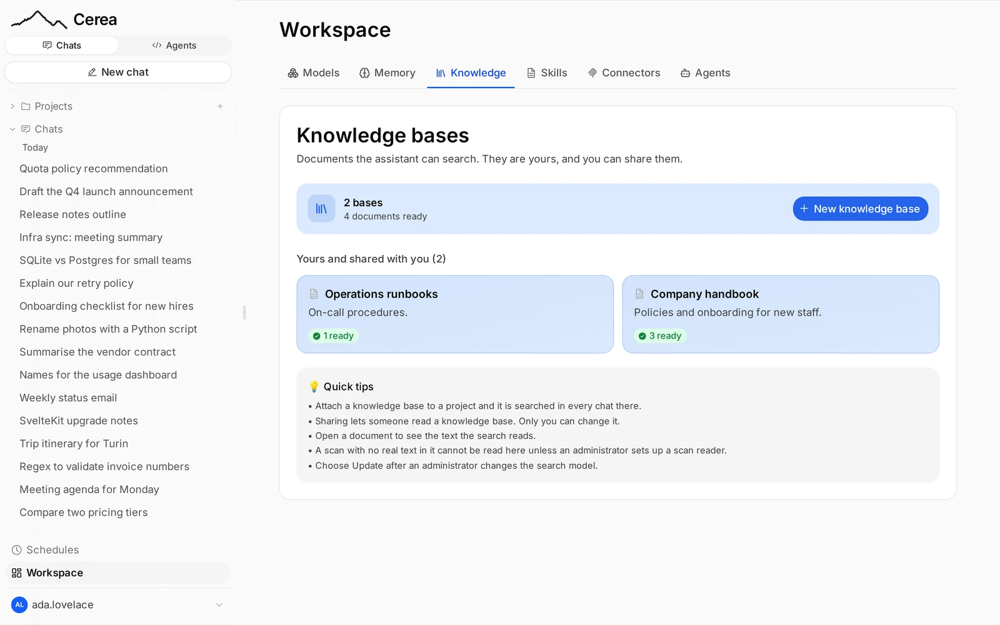

# Knowledge and projects

!!! info "For everyone"

    Knowledge bases the assistant can search and projects that group chats; the last section is for operators.

A **knowledge base** is a set of documents Cerea can search while answering.
You upload files to it, Cerea extracts their text, splits it into passages and
indexes them, and the model is given the passages relevant to each question. A
**project** groups chats that share standing instructions and
knowledge.

## Knowledge bases

Create and fill a base from the **Workspace** page, under **Knowledge**
(`/workspace?tab=kb`). Upload PDFs, Office documents or text files. Each is
**read once, at upload**, and you can open a document to see the text that
search actually uses.

**Accepted files:** PDF, Word, Excel, PowerPoint, OpenDocument, e-books, and
text files (Markdown, CSV, JSON, plain text). The type is decided from the
file's contents, not its name or the browser's guess, so a text file with a
wrong extension is still accepted. Images, archives and other binary files are
refused with a message saying so (HTTP 415); a file stored before this check
that is not text fails its own document with the same reason.

- A **scanned PDF** (pictures of pages, with no selectable text) comes out empty unless your administrator has chosen an OCR model. Open the document to check: if its text is empty, ask them.
  In a **chat**, a scan is also handled by the model: see [Attachments](chat.md#attachments).
- A file that **cannot be read** says why, in the same words to you and to the assistant: no reader is configured for that format, the reader refused the file (and what it said), the reader could not be reached, or the file holds no text. Only a PDF with no text layer is called a scan.
- Your bases are **yours to own and to share**. Sharing a base lets somebody
  read it; only you can change it.
- **You choose the embedding model for each base.** A new base follows the
  administrator's default, shown as "Default (name)". The selector lists the
  embedding models you can use; with only one it is plain text. On an existing
  base, picking another asks first ("Changing the embedder reindexes all N
  documents"), then reindexes with the new model, billed to you. Only the owner
  can change it; other members see the model's name. A base on a model you chose
  never counts as "older" when the administrator moves the default. A base
  shared with you may use a model you are not granted: it is skipped in search
  with "This knowledge base uses <model>, which isn't available to you."
- **A reindex runs in the background.** The base shows its documents as
  indexing, and a second Reindex is refused until the first finishes. The old
  passages are removed when it starts, so the base searches as empty until the
  first documents are re-embedded; a document that fails on the new model stays
  out of search rather than being answered from the old vectors.
- **After an administrator changes the default embedding model**, your bases keep working on the old one and show that they are on an older model. **Reindex** brings a base up to date; it is billed to whoever presses it. The same holds after a change to the embedding **passage prefix** (see [Embedding prefixes](chat-admin.md#embedding-prefixes)).

Indexing is billed to the user indexing, like any other call.

## Projects

A project is a way of organising **chats**. It has **a page of its
own**: the sidebar's **Projects** `+` opens `/projects/new` to create one, and a
project row's `⋯` menu has **Project settings**, which opens `/projects/<id>`
(and **Delete**). The page is one scroll of sections, each editable where it
stands; the text fields and options share one **Save changes**, and everything
that is an action (attaching a base, adding a document, removing a chat) happens
at once.

### What every chat in a project is given

Five levels, always in this order. The first three are sent **in full on every
message**; the last two are **searched**, so only what matches your question
arrives. The page lists them at the top, in this order:

1. **Standing instructions**: prepended to the system prompt of every
   chat in the project (in full).
2. **Context documents**: files you attach to the project (in full; see below).
3. **Project memory**: the project's shared notes (in full; see [Project memory](#project-memory)).
4. **Knowledge bases** attached to the project, searched on every turn (up to
   the project's retrieval limit, six passages by default).
5. **Past chats**: the project's own earlier chats, searched, when you
   turn that on (see [Past chats](#past-chats)).

The page also holds the project's **name and description**, its **chats** (each
with a link, **Remove from project** and, for your own chats, **Delete**), an
**Artifacts** tab with what the assistant made in your own chats of the project
(see [The Artifacts tabs](artifacts.md#the-artifacts-tabs)),
**sharing** and the **defaults for
new chats**: web search on or off; when the project leaves it unset, the app
default applies. A project no longer picks the [connectors](connectors.md) new
chats start with: that setting is retired, and connectors are switched on and
off for you in Workspace → Connectors.

**Knowledge bases can be attached or detached at any time**, not only when the
project is created: search the list under **Knowledge bases** and press
**Attach**. To make a base, use the link to the Workspace's Knowledge tab.

**Deleting a project deletes its chats** (the ones you started, with everything
a deleted chat leaves behind), its notes, its context documents and its
past-chats knowledge base, the one that lets the assistant remember the
project's chats. Tick **Keep the project's chats as regular chats** in the
confirmation to move your chats back to your ordinary list instead. Knowledge
bases attached to the project are their own resources with their own owner, so
they are kept. In a shared project, chats other users started are never
deleted: they go back to those users' own lists.

**Remove from project** does the same for one chat: the chat returns to your
ordinary list and its transcript leaves the project's past-chats memory. You can
remove a chat you started; the project's owner can remove any. **Delete** in the
same menu deletes one of your own chats for good, after the same confirmation
the sidebar's menu shows.

### Context documents

Attach files to a project and the **full extracted text of each goes into every
message** in that project's chats, like a chat [attachment](chat.md#attachments)
and unlike a knowledge base. Use them for the few things the assistant should
always have in front of it: a call text, a style guide, a contract.

- **Files, not folders.** Add individual files (several at once is fine); a
  dropped folder is refused, because whole documents go into every prompt and a
  folder is how a project ends up with a thousand of them. Text files (`.txt`,
  `.md`, `.csv`, `.json`…) and documents (PDF, Word, Excel, PowerPoint,
  OpenDocument, EPUB), up to 10 MB each.
- **Read once, at upload**, by the same reader as chat attachments, with the
  same failure reasons. A file that cannot be read **stays listed with its
  reason** and adds nothing to the prompt.
- **A budget of 100,000 characters** of extracted text per project. Each
  document shows its size in characters and roughly tokens (about four
  characters to a token), and a bar shows the total. Past **50,000** the page
  warns that large context makes every message in the project slower and more
  expensive; an upload that would pass 100,000 is **refused**. A project holds
  at most 50 documents.
- **Everyone who can see the project can add and remove documents**, as with
  notes, and each shows who added it. The text goes into the prompt of that
  project's chats only, for users who can still see the project.
- **Deleting** a document removes the stored original and its text. Erasing a
  user's account deletes the documents in projects they own, with the project;
  documents they added to other users' projects stay, and show "deleted user".

### Project memory

A project also keeps a short **list of notes**, its **Project memory**, that every member shares — a
convention, a decision and its reason, where something lives — and that goes
into every chat **in that project** and nowhere else. It is the
[personal memory](chat.md#memory) list, moved from a user to a project, and
it is on whenever the deployment has memory on (`CHAT_MEMORY_ENABLED`); your
own opt-in for personal memory does not apply, because the notes are not about
you.

- **Everyone who can see the project can read, add, edit and delete notes**: the
  owner and everyone it is shared with. That is wider than the project's
  instructions, which only the owner changes. Each note shows who wrote it, its
  date and, if the assistant wrote it, the chat it came from.
- **The assistant can write them too.** In a project chat it is offered
  `remember_for_project` and `forget_for_project` as well as `remember` and
  `forget`, and the change shows in the transcript with an undo.
- **Limits.** A note is at most 2,000 characters and a project keeps 100. The
  prompt block has a budget of 8,000 characters; past it the **oldest** notes
  stop being sent, and the Memory section of the project page marks which.
- **Deleting a project deletes its notes.** Erasing a user's account deletes
  the notes in projects they own, with the project; notes they wrote in other
  users' projects stay, and show their author as "deleted user".
- A note is read by everyone in the project and goes into everyone's prompt, so
  never keep a password, key or token in one.

### Past chats

A project can search its own earlier chats. With **Search this project's
own past chats** on, finished exchanges in the project are indexed into
a knowledge base of their own, the **memory base**, so later chats can draw on
earlier ones. It is **off by default**, because it copies what was said into a
searchable store, and that is a decision worth making rather than discovering.

- The memory base is an **ordinary knowledge base**, named after its project,
  visible on the Knowledge tab and deletable there. The transcripts are
  somewhere you can look.
- Each chat is kept once: as it grows, its copy in the memory base is replaced, never duplicated.
- The project's settings show the index's state (indexed, indexing, failed or
  not indexed). The project's owner can **Reindex** it, or **Retry** the chats
  that failed; a failure says why in plain words. The owner can also pick
  the index's embedding model there, with the same confirmation as on a base. In a shared project, a
  member who is not granted the model you chose does not add their chats to
  the index, and cannot search it. The chat is skipped, and the index does not
  show as failed.

This is a different thing from [personal memory](chat.md#memory), a short list
of facts about you that goes into every chat, and from the project's
[memory](#project-memory) above, a short list of shared notes sent in full.

### Agent workspace

If coding agents are on for you and you have paired a computer, the project's
**Settings** tab has an **Agent workspace** card: the computer and workspace the
coding sessions started from this project's chats run on, and a permission word
(Plan, Ask or Allow; Ask by default). Sessions the chat starts use that word;
a session that already exists keeps its own. It has its own **Save** and
**Remove**, apart from the page's Save changes.

It is **yours alone**. A computer belongs to one user, so in a shared project
each member sets their own target, and nobody sees anyone else's. With no
computer paired the card says so and points to the Agents panel. In a chat, each
session the assistant starts or prompts leaves a card in the chat with
its live state (working, needs you, idle, failed, offline) and an **Open in
/code** link.

## Sharing

You can share a **base** or a **project** with a user (by email address) or a
group (by name).

- **Cerea can't check the name you type.** It can't look up who exists or who is in a group, so a typo in an address and a colleague who hasn't signed in yet look the same. The share list shows what you typed, not who it reached. Check the spelling.
- **A shared project shares its instructions, knowledge and memory, not its chats.**
  Members see only their own chats in it (plus a count of other members'
  chats), and a chat opens for its author only. With past-chat memory on, the
  assistant can recall past chats from all members. The project page says so.
- **Sharing a project shares no documents.** Retrieval runs with the _reader's_
  own identity on every turn, so a reader sees passages only from bases they
  could already read. A project is never a way to publish a document without
  sharing it.

## When a base cannot be searched

**A base that can't be searched never stops an answer.** If the search service is down, you still get an answer, without those passages and without a warning. If an answer ignores a document you expected it to use, ask again later or tell your administrator.

## For operators

|                  |                                                                                                                                                                                               |
| ---------------- | --------------------------------------------------------------------------------------------------------------------------------------------------------------------------------------------- |
| Switch           | `CHAT_KNOWLEDGE_ENABLED`: on unless set to `false`; `false` hides the Knowledge tab and the project and composer affordances                                                                  |
| Passage store    | PostgreSQL with pgvector, as `CHAT_PG_URL`. the deploy kit creates this database on the stack's Postgres. Use **pgvector 0.8.2 or later** (0.8.2 fixed CVE-2026-3172 in parallel HNSW builds) |
| Embeddings       | an embedding model in the gateway's catalogue (`POST /v1/embeddings`), the default is chosen on the Knowledge screen by an administrator; each base can use another the user chooses          |
| Document reading | the gateway's extraction endpoint (`POST /v1/ocr`). The stack's own extractor runs locally, so documents do not leave the deployment unless an operator configures an external OCR model      |

**Who chooses the reader.** The administrator sets only the **default reader**
(Knowledge screen, or fix a default with `CHAT_OCR_MODEL`). The list of readers
is the gateway's OCR models you may use, shown as the gateway lists them: the
built-in extractor's engines and any remote OCR model alike.

- **Each knowledge base** has a **Read documents with** choice, on the create
  form and in the base's settings, starting as the default. Changing it applies
  to files added from then on; documents already read keep their text.
- **Each user** has a default reader for **chat uploads** in their settings
  (Application), starting as the administrator's default.
- **Re-read with…** on a file document in a base reads the stored original again
  with a reader you pick, then re-embeds that document. It runs in the
  background like any indexing, with the same document states and errors.
  Owners and editors only; not offered for pasted text or plain-text files,
  which are never extracted. A base being reindexed, or a document still being
  indexed, answers 409.
- **Past chats** are text and are never extracted, so they have no reader
  choice.

A saved choice must be one you may use, or the save is refused (400). If a
reader stops being available to you later (a revoked grant, a removed model),
reading falls back to the default reader and logs
`document_reader_fallback`; the upload is not failed.

**Which reader takes which file.** The chosen reader is for **PDFs and
images**: an upstream OCR model such as Mistral's reads page pictures. Every
other format (Word, Excel, PowerPoint, OpenDocument, e-books) goes to a
**local reader** (a gateway model flagged `local`: the chosen one when it is
local, otherwise the deployment's default local reader), and is never sent to an
upstream OCR model. With no local reader, an Office file fails with "No reader
for Word documents is configured" rather than being sent somewhere that cannot
read it.

If you restrict a reader model to a group, users outside it cannot choose it,
and their PDFs fall back to the local reader when there is one, and are stored
without text when there is not.
A legacy binary Office file saved under a `.docx` name (it sniffs as a
compound file, not a zip) is sent to the local reader as `application/msword`;
the reader looks at the bytes and either reads it or refuses with its own
reason, which is shown. A deployment with `CHAT_OCR_BASE_URL` and no gateway
reads PDFs only, with no choice to offer.

Changing the default reader needs no reason; one sent by an older client is
still recorded in the change history.

Bases, documents and sharing records live in the chat's MongoDB; passages and
vectors live in PostgreSQL. Back up both (see the [deploy kit](deploy-kit.md) README). The
variables are on [Configuration](configuration.md).

Limits: there is no reranking step yet; ranking runs in half precision over
indexed widths from 384 to 3072 dimensions, and a model embedding wider than
the store indexes is truncated to the largest width it covers (see below). Model weights
for document conversion are not bundled: whatever the extraction endpoint runs
is the operator's choice, under its own licence.

### Wide embedding models

A model whose vectors are wider than the store indexes (for example
`qwen3-embedding-8b` at 4096 dimensions, against a ceiling of 3072) is cut down
to the store's width. The request asks the provider for that width first
(`dimensions`); some providers, Cortecs among them, ignore it and answer at the
native width. For a **Matryoshka (MRL) model**, whose leading components are
trained to work as a shorter embedding, Cerea then truncates each vector itself
and rescales it to unit length. Documents and search queries go through the same
step, so they stay in one space. The model's native width, the width used and
the fact that the provider ignored the request are logged once per base.

Only models known to be MRL-trained are cut: Qwen3 Embedding, OpenAI
`text-embedding-3-small` and `-large`, Nomic Embed Text v1.5 and v2, Jina
Embeddings v3 and v4, mxbai-embed-large, and Snowflake Arctic Embed L v2. Cutting
any other model would give meaningless vectors, so its documents fail with a
message naming the width, and the fix is to pick another embedding model.
